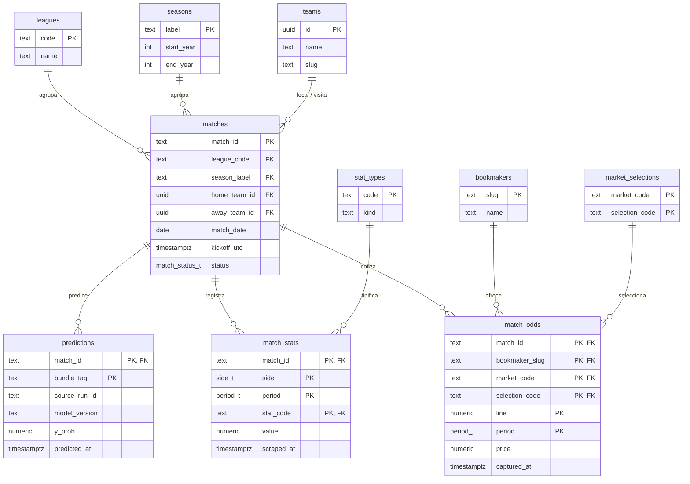

# SPEC 07 — Persistencia en Supabase para inferencia en vivo

> **Status:** Implementado
> **Depends on:** SPEC 01, SPEC 03, SPEC 05, `specs/ideas/inference-deliverables.md`
> **Date:** 2026-08-05
> **Objective:** Reemplazar el CSV como fuente de verdad del camino live por un esquema Supabase normalizado (3FN) que separa lo que se escribe en momentos distintos, y migrar el dataset histórico hacia él sin pérdida de información.
> **Ejecución:** Claude Code ejecuta directamente, vía MCP (`mcp__supabase__*`), todo lo relacionado con Supabase de este spec — migraciones DDL, seed de dimensiones, upserts, y verificación de los criterios de aceptación — en vez de que el usuario corra los comandos a mano.

---

## Por qué este spec existe

Hoy el único almacenamiento del proyecto es CSV vía `MatchStore` (`scraping/store.py`), que
**sobrescribe la fila entera por `match_id`** en cada `flush()`. Eso es correcto para un
scrape de temporada completa en un solo pase, pero es inservible para el flujo de inferencia
en vivo de `specs/ideas/inference-deliverables.md`, donde odds, stats de 1er tiempo y
resultado final se conocen en **tres momentos distintos** del mismo partido: una segunda
escritura pisaría a la primera.

Dos requisitos, dados explícitamente, fijan la forma del esquema:

1. **Tiene que estar normalizado** (3FN), no ser una tabla ancha calcada del CSV.
2. **Van a agregarse cuotas O/U 0.5 y 2.5** además de las 1.5 actuales, y el diseño tiene que
   absorberlo sin DDL nuevo.

El requisito 2 es el que más pesa: el CSV codifica la línea en el *nombre de columna*
(`ou15_bet365_under_1ht`), lo que obligaría a un `ALTER TABLE` por cada línea nueva. Sumado a
que **el set de casas de apuestas es geolocalizado y depende de la IP**
(`docs/scraping_pipeline.md:376-384` — aparecen y desaparecen casas solas), un esquema ancho
queda descartado de entrada a favor de formato largo (EAV acotado, no EAV genérico: las
columnas de cada hecho están tipadas, solo la línea/stat es dato).

---

## Scope

**In:**

- DDL de Supabase (Postgres): dimensiones, hechos, enums, una vista, índices.
- Capa de acceso Python (`src/core/supabase.py`) con upserts idempotentes y
  `load_season_history(season)`.
- Utilidades de pivot largo ↔ ancho (`src/core/wide_format.py`) que reproducen exactamente los
  nombres de columna que ya emite `scraping/scrape.py` (`{side}_{stat}_{period}`,
  `ou{line}_{casa}_{selection}_{period}`) y, para el mercado `match_winner`, los que ya emite
  el merge de footballdata.co.uk (`{casa}_odds_{selection}`, hoy `b365_odds_{home,draw,away}`).
- Script de migración histórica desde
  `data/raw/scraped/bundesliga/unified/df_bundesliga_2013_2026.csv` (3.978 partidos,
  228 columnas) hacia Supabase, idempotente y reanudable, más las 3 columnas
  `b365_odds_{home,draw,away}` de `data/raw/final/df_bundesliga_unified.csv` (mismo `match_id`
  que el CSV de Flashscore — ver nota abajo — sin necesidad de mapear partidos por
  equipos+fecha).
- Test de round-trip que prueba que CSV → Supabase → CSV es idéntico, y test de paridad de
  features contra el camino offline existente.

**Sobre `match_winner` (agregado en revisión, ver Decisions):** el spec original dejaba las
cuotas de winner/1X2 sin poblar porque asumía que requerían mapear partidos entre Flashscore y
footballdata.co.uk (equipos+fecha, sin ID común). En la práctica ese mapeo **ya está resuelto**:
`exploratory/notebooks/target_definition.ipynb` ya mergeó footballdata.co.uk sobre el dataset de
Flashscore conservando su `match_id`, y ese resultado ya vive en
`data/raw/final/df_bundesliga_unified.csv` (mismos 3.978 `match_id`, sin nulos en
`b365_odds_home/draw/away`). Dado que no hay mapeo nuevo que resolver, poblar `match_winner`
pasa a estar dentro de este spec.

**Out of scope (para specs futuros):**

- Los modos de scraping que **escriben** a estas tablas en producción (discovery de fixtures,
  split del scraper en fases odds/1HT/resolución) — son los entregables 2 y 3 de
  `specs/ideas/inference-deliverables.md`.
- El pipeline de inferencia que **lee** `load_season_history` y escribe `predictions` —
  entregable 4.
- Los workflows de GitHub Actions que orquestan todo lo anterior — entregable 5.
- Usar `match_winner` o las líneas 0.5/2.5 como features en `feature_registry.yaml`: el
  esquema las soporta y `match_winner` ya está poblado (ver nota arriba), pero consumirlas es
  trabajo de Feature Engineering, no de este spec.
- Migrar cualquier otra columna de footballdata.co.uk además de `b365_odds_{home,draw,away}`
  (ese dataset trae más mercados y casas — ver `data/footballdatacouk-bundesliga/notes.txt`):
  spec futuro si hace falta.
- Políticas RLS finas para la web estática (`architecture.md` §6.4): se deja read-only con
  anon key a nivel de tabla; el detalle por columna se resuelve en
  `specs/12-web-supabase-read-access.md`.
- Historizar el movimiento de la línea de apuestas: `match_odds.captured_at` deja el campo
  abierto, pero este spec no agrega snapshots repetidos por partido.

---

## Data model

### Diagrama

El `.drawio` editable, con la misma notación crow's foot, vive en
`diagrams/data_model.drawio` (misma convención que `diagrams/architecture.drawio`).

### Dimensiones

| Tabla | Columnas | Por qué existe así |
|---|---|---|
| `leagues` | PK `code` (`bundesliga`), `name` | Multi-league ya está en `training-pipeline-backlog`; dejarlo listo cuesta cero acá. |
| `seasons` | PK `label` (`2013-2014`), `start_year`, `end_year` | **Sin `league_id`.** Una temporada es una ventana de tiempo, no una propiedad de la liga — Bundesliga 2013-2014 y otra liga 2013-2014 son la misma fila. Con `league_id` habría dos caminos a la liga (`matches → season → league` y `matches → league`) que nada obliga a mantener coherentes. `label` es lo que ya produce `derive_season` (`scraping/scrape.py:192`) y lo que agrupa el bloque `form` del feature registry — se guarda en vez de derivarse de `match_date` en cada query porque es el valor exacto que el resto del sistema ya usa como clave de agrupación. |
| `teams` | PK `id` (uuid), `name`, `slug` | No cuelga de `league_code`: los equipos ascienden y descienden de división. |
| `stat_types` | PK `code` (`expected_goals`, `corner_kicks`, ...), `kind` (`count`\|`percentage`\|`float`) | **`code` es la PK, no un `id` serial**: así el código ya está presente en la fila de `match_stats` y el join a esta tabla solo hace falta para leer `kind`, no para saber qué stat es cada fila. La FK desde `match_stats` rechaza códigos inventados: sin ella, un typo del scraper (`expected_gaols`) entraría en silencio. `kind` es una propiedad física estable del stat (¿es un conteo, un porcentaje, un float?), no una decisión de modelado — por eso es lo único que se guarda acá. **`clip_to_zero`/`allows_negative` deliberadamente no viven en esta tabla** (ver Decisions): son una decisión de EDA sobre una corrida específica, ya versionada por modelo dentro de `fe_{track}_feature_spec.yaml` (`raw_inputs[].clip_min`, `step_07_assembly.py:102-104`). Sembrarlas una vez acá las congelaría, mientras que `predictions.bundle_tag` ya asume que conviven varios modelos con posibles decisiones de EDA distintas sobre el mismo stat. |
| `bookmakers` | PK `slug` (`bet365`), `name` | Se insertan on-the-fly con el `slugify()` que ya existe en `scraping/config.py`. Una casa nueva por geolocalización es un `INSERT`, no un `ALTER TABLE`. |
| `market_selections` | PK compuesta `(market_code, selection_code)` | **Sin tabla `markets` separada.** Filas de hoy: `(over_under, over)`, `(over_under, under)`; de mañana: `(match_winner, home)`, `(match_winner, draw)`, `(match_winner, away)`. La PK compuesta hace que las selecciones válidas dependan del mercado — un enum plano de selecciones no puede expresar que `over` no aplica a `match_winner`. |

Enums nativos de Postgres para lo que no merece tabla propia:

- `period_t` = `1ht` \| `2ht` \| `ft`
- `side_t` = `home` \| `away`
- `match_status_t` = `scheduled` → `odds_scraped` → `live` → `ht_scraped` → `predicted` →
  `finished` → `resolved` (la máquina de estados que van a leer los workflows del entregable 5)

### Hechos

- **`matches`** — PK `match_id text` (la clave natural de Flashscore, se conserva tal cual).
  FKs a `leagues`, `seasons`, `teams` (home y away). `match_date date` es una versión sin hora
  del `date` del CSV, útil para agrupar por día/temporada. `status match_status_t`,
  `created_at`, `updated_at`.

  **`kickoff_utc timestamptz` sí se puebla para el histórico** (corrección en revisión, ver
  Decisions): el spec original lo dejaba solo para el scheduling en vivo del entregable 5,
  asumiendo que `match_date` (sin hora) alcanzaba para reconstruir features de fecha. Es falso:
  `days_rest` (`{prefix}.diff().dt.days` entre kickoffs consecutivos de un equipo, bloque
  `temporal`/`form`) es sensible a la hora, no solo al día calendario — perder la hora corría el
  conteo de días ±1 en ~25% de una muestra real, detectado por el test de paridad de features
  (paso 7) antes de este fix. `kickoff_utc` guarda el timestamp local del CSV **tal cual**,
  sin fabricar una conversión a UTC real (la zona horaria del scraper no está documentada en
  ningún lado — inventar un offset habría introducido un error nuevo en vez de corregir uno).

- **`match_stats`** — PK `(match_id, side, period, stat_code)`. `value numeric`,
  `scraped_at timestamptz`. Una sola tabla para 1er y 2do tiempo, con `period` como
  discriminador — no dos tablas separadas: se escriben en momentos distintos, pero eso lo
  resuelve el `UPSERT` por PK, no el particionado. Dos tablas con columnas idénticas serían la
  misma entidad partida por el valor de una columna.

  **Consecuencia del formato largo:** una stat ausente es una fila ausente, no un `NULL`. Esto
  implementa literalmente la política del proyecto ("missing is always NaN, never 0",
  `CLAUDE.md`) sin necesidad de ningún valor centinela: al pivotear de vuelta a ancho, la
  combinación `(side, period, stat_code)` que no tiene fila sale `NaN` sola. Las temporadas
  sin xG (2013-2016) simplemente no tienen esas filas.

- **`match_odds`** — PK real `(match_id, bookmaker_slug, market_code, selection_code,
  line_key, period)`, con `(market_code, selection_code)` como FK compuesta a
  `market_selections`. `price numeric(6,3)`, `captured_at timestamptz`. **`line numeric(4,2)`:
  1.50 hoy; 0.50 y 2.50 mañana son filas nuevas, no columnas nuevas** — esta es la columna que
  resuelve el requisito 2 del spec. `line` es `NULL` para mercados sin línea (`match_winner`,
  poblado — ver más abajo).

  **`line_key`, no `line`, es la columna de la PK** (corrección en revisión, ver Decisions):
  Postgres pone `NOT NULL` implícito en toda columna de una PK, así que `line` en la PK
  contradecía la propia frase de arriba ("`line` es `NULL` para `match_winner`") — el primer
  insert de `match_winner` lo destapó. `line_key numeric(4,2) generated always as
  (coalesce(line, -1)) stored` es una columna generada, siempre no nula, que reemplaza a
  `line` en la PK; `line` en sí queda nullable y fuera de la key. Dos `NULL` nunca son
  "iguales" para SQL, así que sin este sentinel el `upsert` de `match_winner` insertaría una
  fila nueva en cada corrida en vez de actualizar — `line_key` es lo que lo vuelve idempotente.

- **`predictions`** — PK `(match_id, bundle_tag)`. `source_run_id`, `model_version`,
  `y_prob numeric` (probabilidad cruda, **sin calibrar** — decisión ya tomada en
  `specs/ideas/inference-deliverables.md`, el calibrador no viaja en el bundle publicado),
  `predicted_at`. La PK compuesta permite que dos versiones de modelo convivan sobre el mismo
  partido (lo que pide `diagrams/architecture.md` §6.2, "lets model versions be compared on
  the same matches") y que un re-run del cron con el mismo `bundle_tag` sea idempotente en vez
  de duplicar filas.

### Vista

- **`v_match_results`** — `match_id`, `home_goals_1ht`, `away_goals_1ht`, `home_goals_2ht`,
  `away_goals_2ht`, `total_goals_2ht`. Es **vista, no tabla**: los goles ya son un `stat_code`
  (`goals`) dentro de `match_stats`; materializarlos en una tabla aparte sería duplicación pura
  y rompería 3FN. Si el plan de ejecución sufre en el camino caliente de `form` (que necesita
  `home/away_goals_2ht` de toda la historia de temporada), se promueve a vista materializada
  sin cambiar la interfaz que consume `load_season_history`.

  **Sin `target_binary` en la vista.** La línea O/U que define el target (0.5, 1.5, 2.5, ...)
  es una decisión por modelo, no una propiedad fija del partido: el mismo razonamiento que ya
  aplica el spec para `clip_to_zero`/`allows_negative` en `stat_types` (ver Decisions) — si
  mañana conviven varios modelos, cada uno con su propia línea, congelar un único umbral acá
  rompería para todos menos uno. `total_goals_2ht` queda crudo en la vista; el binario se
  calcula aguas abajo, en el momento de entrenar/inferir, con la línea que corresponda a cada
  modelo (hoy 1.5, vía `scraping/target/generate_target.py`).

### Reconstrucción del contrato ancho

El pipeline de FE/inferencia necesita exactamente los nombres `{side}_{stat}_{period}` y
`ou{line}_{casa}_{selection}_{period}` que ya produce `read_stats()`
(`scraping/scrape.py:130`). Esa reconstrucción vive en **`src/core/wide_format.py`, en
pandas, no en SQL** — Postgres no tiene pivot dinámico, y son dos funciones (`stats_to_wide`,
`odds_to_wide`) que hacen `pivot_table` sobre el resultado largo.

> **Nota para cuando entren las líneas 0.5 y 2.5:** el pivot pasaría a emitir columnas
> `ou05_*` y `ou25_*` sin cambios de esquema. El modelo publicado hoy **no se rompe** —
> sigue pidiendo `ou15_bet365_under_1ht` (único par que sobrevivió la selección de
> `config/feature_registry.yaml`) y lo sigue encontrando — pero usar las líneas nuevas como
> features requiere tocar `market_prefix` en el registry, que es trabajo de FE, no de este
> spec.

Los valores se guardan **crudos, sin clipear**. Los contadores levemente negativos que
documenta `CLAUDE.md` ("Known Data Issues") se conservan tal cual llegan del scraper: la base
es fiel al scrape. El clipping se aplica aguas abajo, en el entregable 4, leyendo el
`raw_inputs[].clip_min` del `feature_spec.yaml` del bundle activo — no un flag estático de
Supabase (ver Decisions).

---

## Implementation plan

1. **`supabase/migrations/0001_schema.sql`** — enums (`period_t`, `side_t`,
   `match_status_t`), las 6 tablas de dimensión y hecho descritas arriba, la vista
   `v_match_results`, e índices sobre `match_stats(match_id)`, `match_odds(match_id)`,
   `matches(season_label)`, `matches(status)`. Verificación manual: `supabase db reset` local
   aplica sin error.

2. **`supabase/migrations/0002_seed_dimensions.sql`** — inserta `leagues` (`bundesliga`),
   `market_selections` (las 2 filas de `over_under`) y los 47 `stat_types` con su `kind`
   (`count`/`percentage`/`float`, una propiedad física estable del stat, no una decisión de
   modelado — ver Decisions). Verificación: `select count(*) from stat_types` = 47.
   **`0003_seed_match_winner_selections.sql`** agrega las 3 filas de `match_winner` (ver nota
   "Sobre `match_winner`" en Scope). **`0004`/`0005_fix_match_odds_line_*.sql`** corrigen un
   bug de la PK de `match_odds` destapado al poblar `match_winner` — ver Decisions.

3. **`src/core/wide_format.py`** — `stats_to_wide(df_long) -> pd.DataFrame`,
   `odds_to_wide(df_long) -> pd.DataFrame`, y sus inversas `stats_to_long`/`odds_to_long` para
   el migrador. Tests unitarios en `tests/unit/test_wide_format.py`, incluyendo el caso de una
   fila con `line=2.5` para probar que el nombre de columna sale bien formado sin tocar el
   código del pivot.

4. **`src/core/supabase.py`** — cliente (`supabase-py`), funciones de upsert idempotente por
   tabla (`on_conflict` sobre cada PK compuesta), y `load_season_history(season_label) ->
   pd.DataFrame` que junta `matches` + `match_stats` (pivoteado) + `v_match_results` para una
   temporada — el frame que va a necesitar el bloque `form` del entregable 4. No importa
   `mlflow` ni lee `run_registry.json` (mismo boundary que ya rige
   `src/pipelines/feature_engineering/{features,registry}.py`).

5. **`scripts/migrate_csv_to_supabase.py`** — idempotente y reanudable:
   - lee el unified CSV (`sep='|'`);
   - upsert de `teams` (valores distintos de `team_home`/`team_away`), `seasons` (valores
     distintos de `season`), `bookmakers` (prefijos de las 34 columnas `ou15_*`);
   - upsert de `matches` con `status='resolved'` (todo lo histórico ya terminó) y
     `kickoff_utc` = timestamp local del CSV tal cual (ver Decisions);
   - `stats_to_long()` sobre las 188 columnas de stats, descartando NaN, upsert por lotes;
   - parseo de las 34 columnas `ou15_*` a filas `market_code='over_under'`, `line=1.5`,
     descartando NaN, upsert por lotes;
   - lee además `data/raw/final/df_bundesliga_unified.csv` (mismo `match_id`, ver nota "Sobre
     `match_winner`") y sube `b365_odds_{home,draw,away}` como filas `market_code='match_winner'`,
     `line=NULL`, `period='ft'`.
   Verificación: correrlo dos veces no duplica ni cambia el conteo de filas.

6. **`tests/integration/test_supabase_round_trip.py`** — el criterio de aceptación real: leer
   todo de Supabase para las temporadas migradas, pivotear con `wide_format` y comparar contra
   el CSV original con `pd.testing.assert_frame_equal` (columnas y filas alineadas). Si el
   round-trip no es idéntico —incluyendo que los `NaN` sigan siendo `NaN`— la migración no está
   terminada.

7. **Test de paridad de features** — correr
   `src/pipelines/evaluation/step_03_features_test.py` (el camino offline existente) sobre el
   frame reconstruido desde Supabase para un subconjunto de partidos del Test set, y comparar
   la matriz de features resultante contra la que produce el CSV. Defensa directa contra
   train/serving skew, y deja el entregable 4 apoyado en algo ya verificado.

8. **Corrección de `CLAUDE.md`**: la regla `season` XOR `id_match` se valida en
   `scraping/run.py:50-68`, no en `scraping/config.py` como dice hoy.

---

## Acceptance criteria

- [x] `supabase db reset` aplica `0001_schema.sql` y `0002_seed_dimensions.sql` sin error.
- [x] `select count(*) from stat_types` devuelve 47.
- [x] `uv run python scripts/migrate_csv_to_supabase.py` migra los 3.978 partidos del unified
      CSV sin error.
- [x] Correr el script de migración una segunda vez no cambia el conteo de filas de ninguna
      tabla (idempotencia).
- [x] `uv run pytest tests/integration/test_supabase_round_trip.py` pasa: el CSV reconstruido
      desde Supabase es idéntico al original, `NaN` incluidos.
- [x] `uv run pytest tests/unit/test_wide_format.py` pasa, incluyendo el caso de una fila con
      `line=2.5` pivoteada a `ou25_*` sin cambios de código.
- [x] El test de paridad de features (paso 7) pasa para el subconjunto de partidos probado.
- [x] Insertar a mano una fila en `match_odds` con `line=0.5` no requiere ningún cambio de
      esquema ni migración nueva.
- [x] `select count(*) from match_odds where market_code='match_winner'` devuelve 11.934
      (3.978 partidos × 3 selecciones), sin nulos en `price`.
- [x] Correr el script de migración una segunda vez no cambia el conteo de filas de
      `match_odds` para ningún `market_code` (idempotencia también para `match_winner`, vía
      `line_key`).
- [x] `select count(kickoff_utc) from matches` devuelve 3.978 (poblado para todo el
      histórico, no solo para partidos futuros).
- [x] `CLAUDE.md` referencia `run.py` y no `config.py` para la regla `season`/`id_match`.

---

## Decisions

- **Sí:** formato largo (EAV acotado y tipado) para `match_stats` y `match_odds`. Es lo único
  que absorbe líneas de apuesta nuevas y casas de apuestas geolocalizadas sin DDL.
- **No:** tabla ancha calcada del CSV. Viola el requisito de normalización explícito y
  requeriría una migración de esquema por cada línea O/U nueva.
- **Sí:** `seasons` sin `league_id`. Evita el camino redundante hacia `leagues` que se abría
  pasando por `matches`.
- **No:** `league_id` en `seasons`. Descartado en revisión — ver arriba.
- **Sí:** `stat_types.code` como PK natural en vez de un `id` serial. El código ya viaja en
  cada fila de `match_stats`; el serial solo agregaría una indirección sin beneficio.
- **No:** guardar `clip_to_zero`/`allows_negative` en `stat_types`. Descartado en revisión:
  esas flags no son una propiedad física del stat sino una **decisión de EDA sobre una
  corrida específica**, que ya viaja versionada por modelo dentro de
  `fe_{track}_feature_spec.yaml` (`raw_inputs[].clip_min`). Sembrarlas una sola vez en una
  tabla estática las congela en el momento del seed, mientras que `predictions.bundle_tag` ya
  asume que conviven varias versiones de modelo — cada una con su propia decisión de EDA,
  potencialmente distinta, sobre el mismo `stat_code`. Una tabla global no puede representar
  eso; el bundle sí, porque va versionado. `stat_types` queda solo con `kind`, que es
  efectivamente estable entre corridas.
- **Sí:** colapsar `markets` dentro de `market_selections` con PK compuesta
  `(market_code, selection_code)`.
- **No:** tabla `markets` separada con `market_id`/`selection_id` juntos en `match_odds`.
  Descartada en revisión: esa forma dejaba pasar filas incoherentes
  (`market=match_winner` + `selection=over`) porque el mercado dependía transitivamente de la
  selección — una violación de 3FN, no solo un exceso de tablas.
- **Sí:** `matches.match_date` y `kickoff_utc` son columnas separadas — `match_date` para
  agrupar por día/temporada, `kickoff_utc` para lo que necesite precisión de hora.
- **No:** dejar `kickoff_utc` sin poblar para el histórico (posición original del spec).
  Descartado en revisión: el test de paridad de features (paso 7) mostró que `match_date`
  solo no reproduce `days_rest` con exactitud. Poblar `kickoff_utc` con el timestamp local del
  CSV, sin conversión a UTC fabricada (zona horaria del scraper no documentada), resolvió el
  gap sin introducir un error nuevo.
- **Sí:** `predictions.y_prob` sin calibrar, PK compuesta con `bundle_tag`. Decisión heredada
  de `specs/ideas/inference-deliverables.md`: el bundle publicado hoy no incluye calibrador ni
  threshold.
- **No:** guardar el movimiento histórico de la línea de apuesta (múltiples `captured_at` por
  partido) en este spec. `captured_at` deja la columna lista, pero poblarla con más de un
  snapshot es trabajo futuro, no de este entregable.
- **No:** vista materializada para `v_match_results` desde el arranque. Se empieza como vista
  simple; se promueve solo si el rendimiento del bloque `form` lo exige.
- **No:** `target_binary` como columna de `v_match_results`. Descartado en revisión: la línea
  O/U que define el target es una decisión por modelo (hoy 1.5, mañana potencialmente 0.5 y
  2.5 en paralelo), mismo argumento ya usado para no sembrar `clip_to_zero`/`allows_negative`
  en `stat_types` — una vista compartida no puede tener un solo umbral correcto para varios
  modelos a la vez. `v_match_results` expone `total_goals_2ht` crudo; cada pipeline de
  training/inferencia calcula su propio binario con su propia línea.
- **Sí:** poblar `match_winner` (cuotas 1X2 de bet365) dentro de este spec, no en uno futuro.
  Descartado como fuera de scope en la primera pasada del spec asumiendo que requería mapear
  partidos entre Flashscore y footballdata.co.uk (equipos+fecha, sin ID común); en revisión se
  confirmó que ese mapeo **ya existe** — `exploratory/notebooks/target_definition.ipynb` ya
  mergeó ambas fuentes conservando el `match_id` de Flashscore, resultado que vive en
  `data/raw/final/df_bundesliga_unified.csv`. Sin mapeo nuevo que resolver, dejarlo sin poblar
  no tenía justificación de scope real.
- **Sí:** `match_winner` guarda `bookmaker_slug='b365'`, distinto de `bookmaker_slug='bet365'`
  que ya usan las filas `over_under` — aunque sea la misma casa real. Prioriza el round-trip
  exacto de nombre de columna con cada fuente (`b365_odds_home` de footballdata.co.uk vs
  `ou15_bet365_under_1ht` de Flashscore) por sobre fabricar una identidad cruzada entre fuentes
  que ninguna de las dos declara.
- **No:** `line` como parte de la PK de `match_odds` (bug del diseño original, corregido en
  `0004`/`0005_fix_match_odds_line_*.sql`). Ver la nota en `line_key` arriba.

---

## Risks

| Riesgo | Mitigación |
|---|---|
| El pivot de formato largo a ancho es más lento que leer un CSV plano, y `form`/`temporal` necesitan la historia completa de una temporada en cada inferencia | `load_season_history` se cachea a nivel de request en el entregable 4; si no alcanza, `v_match_results` se promueve a vista materializada (mismo contrato) |
| Migración parcial deja `matches` sin sus `match_stats`/`match_odds` si el script se interrumpe a mitad | Cada `INSERT`/`UPSERT` es por partido y por lote, no una transacción única de 3.978 filas; correr el script de nuevo retoma sin duplicar (idempotencia probada en el criterio de aceptación) |
| El tier gratuito de Supabase (500MB) se queda corto si `match_odds` crece con historial de línea | Estimado actual (~750k filas de stats tras descartar NaN, ~135k de odds) deja margen amplio; si se agrega historial de línea en el futuro, revisar antes de habilitarlo |
| Un `stat_code` nuevo del scraper (typo o stat nueva de Flashscore) rompe el `INSERT` por la FK a `stat_types` | Comportamiento deseado: falla explícito en vez de silencioso. El script de migración historiza cualquier `stat_code` no reconocido como error, no como fila descartada |

---

## What is **not** in this spec

- El modo de scraping que descubre fixtures por fecha/estado y escribe `matches` en
  producción — spec propio (entregable 2).
- El split del scraper en fases odds/1HT/resolución que **escriben** a `match_stats` /
  `match_odds` en vivo — spec propio (entregable 3).
- El pipeline de inferencia que lee `load_season_history` y escribe `predictions` — spec
  propio (entregable 4).
- Los workflows de GitHub Actions que orquestan todo el flujo en vivo — spec propio
  (entregable 5).
- Poblar o consumir cuotas de winner/1X2 y las líneas O/U 0.5/2.5 como features — trabajo de
  Feature Engineering.
- RLS por columna para la web estática — `specs/12-web-supabase-read-access.md`.

Cada uno de estos, cuando se aborde, va en su propio spec.
